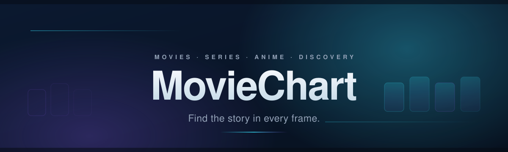
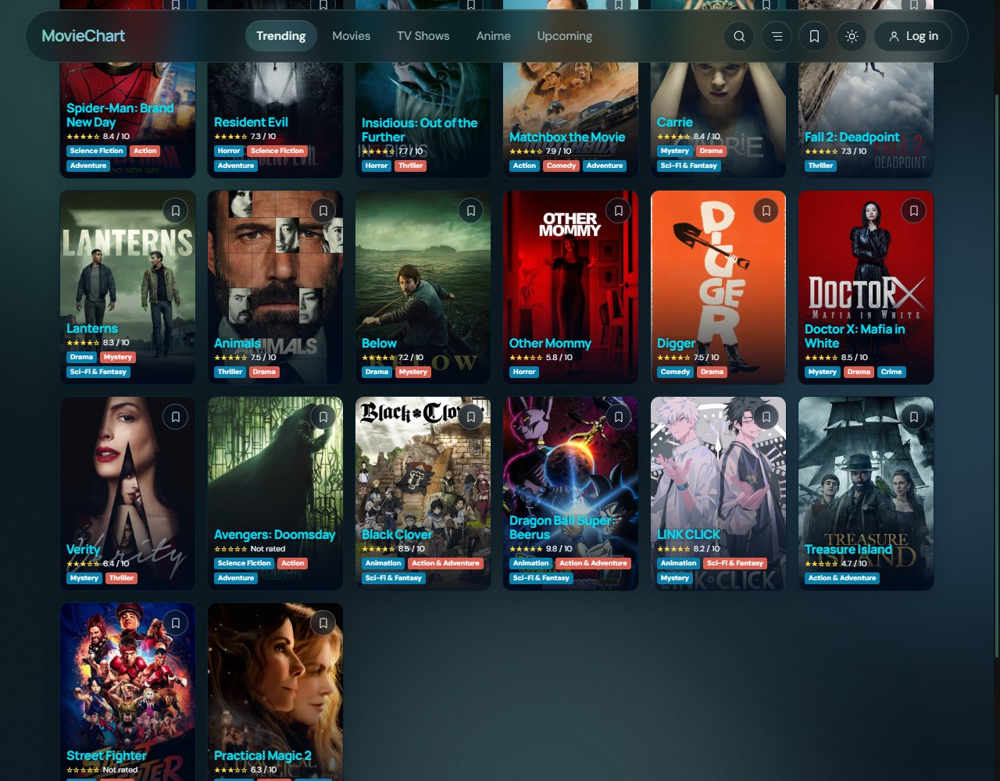
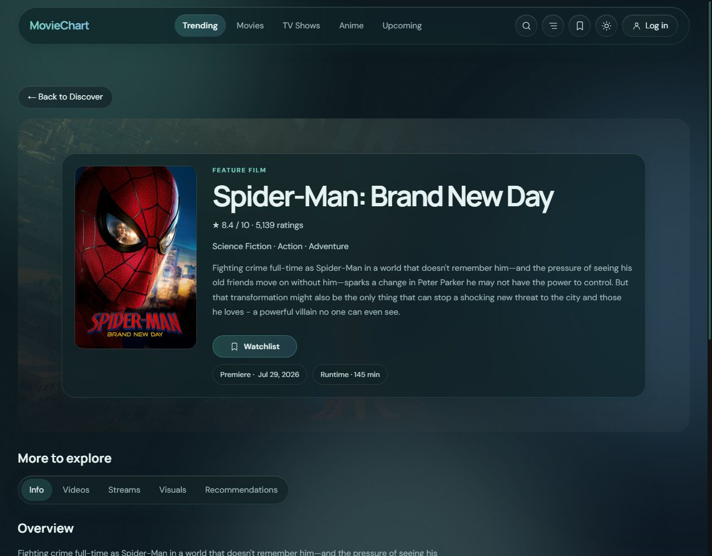
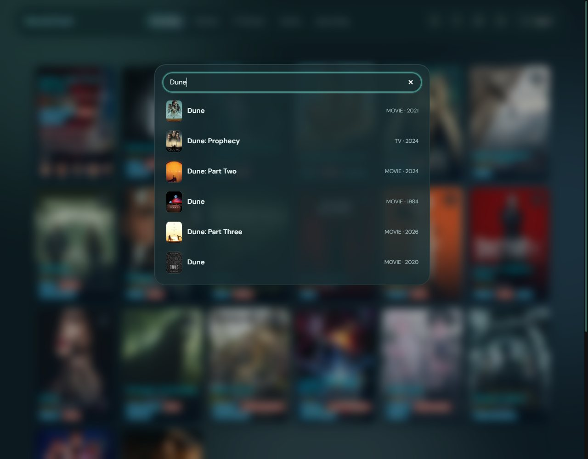
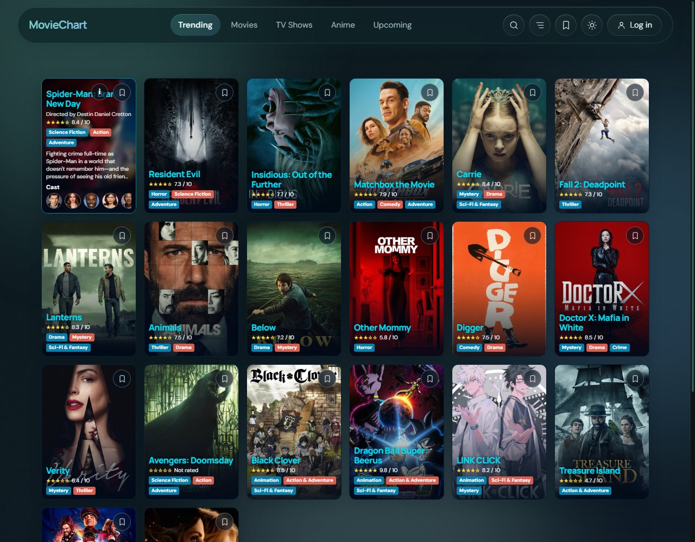
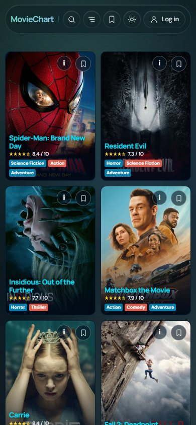
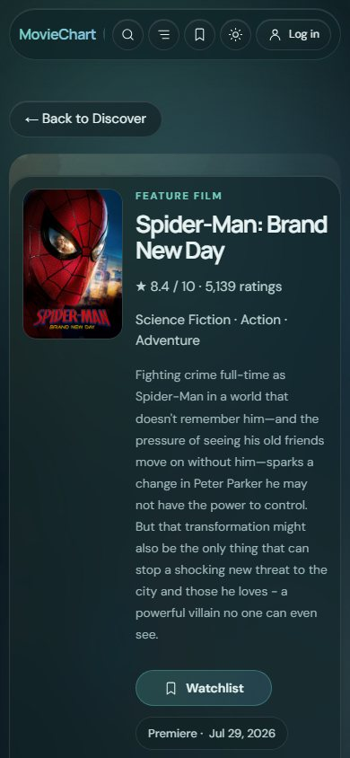
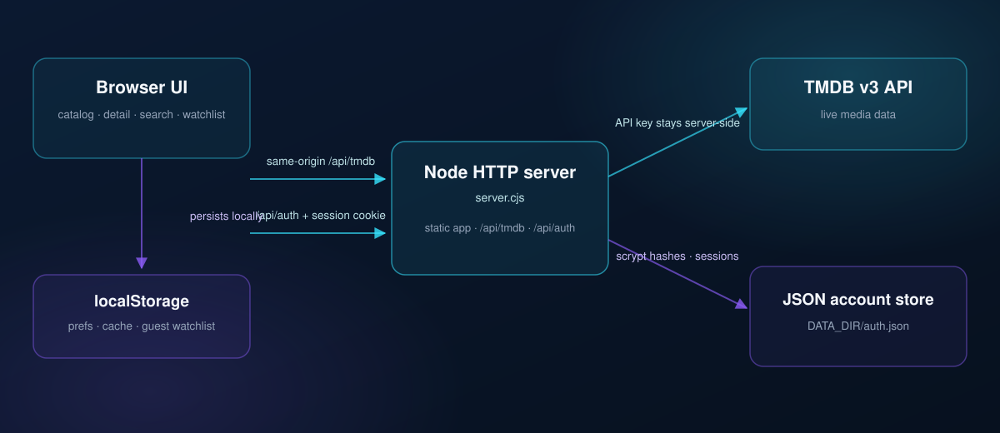

<div align="center">
  <a name="top"></a>
  

  <h1>MovieChart</h1>
  <p><strong>Find the story in every frame.</strong></p>
  <p>A cinematic discovery catalog for movies, television, seasonal anime and upcoming releases, live TMDB data, refined poster cards, deep title details and a watchlist that follows you across devices.</p>

  <p>
    
    
    
    
  </p>

  <p>
    <a href="#overview">Overview</a> ·
    <a href="#features">Features</a> ·
    <a href="#preview">Preview</a> ·
    <a href="#tech-stack">Tech Stack</a> ·
    <a href="#getting-started">Getting Started</a> ·
    <a href="#configuration">Configuration</a> ·
    <a href="#architecture">Architecture</a> ·
    <a href="#testing">Testing</a> ·
    <a href="#security">Security</a> ·
    <a href="#contributing">Contributing</a>
  </p>

  
  <p><em>The Trending catalog in the running application · live TMDB data · captured locally at 1280 × 1000.</em></p>
</div>

## Overview

MovieChart is a self-contained media-discovery web app: browse live TMDB catalogs, narrow them with filters, search across titles and people, open rich detail pages and keep a watchlist, anonymously in the browser or synced to an account. The entire product is one Node.js server, one strict-TypeScript front end and zero production dependencies.

### At a glance

| | |
| --- | --- |
| **Product** | MovieChart, cinematic movies, series and anime discovery |
| **Front end** | Strict TypeScript (ES2022 modules), semantic HTML, hand-built CSS design system with dark/light themes |
| **Back end** | Node.js built-in HTTP server, static app, same-origin TMDB proxy and first-party account API |
| **Media data** | TMDB v3 (trending, discover, search, details, seasons, videos, images, watch providers) |
| **Accounts** | Email + password · salted `scrypt` hashes · opaque server-side sessions |
| **Persistence** | JSON account store (`DATA_DIR/auth.json`) · browser localStorage for cache, preferences and guest watchlist |
| **Quality** | 16 automated tests, Node test runner plus headless-Chrome end-to-end flows |
| **Runtime** | Node.js 18+ · one dev dependency (TypeScript) · no bundler, no framework |

## Features

### Discover and explore

| | |
| --- | --- |
| **Five live catalogs** | Trending, Movies, TV Shows, Anime and Upcoming, each mapped to the right TMDB endpoint. |
| **Upcoming, your way** | Narrow Upcoming to movies, TV, seasonal anime or Asian dramas (Korean, Chinese and Japanese originals). |
| **Sort and filter** | Reorder by popularity, rating or title; filter by language and release status; pick an anime season and year. |
| **Endless browsing** | Load-more buttons backed by an intersection observer, loading skeletons and honest empty and retry states. |

### Search and navigation

| | |
| --- | --- |
| **Global multi-search** | One dialog searches titles and people together, with posters and known-for context in every suggestion. |
| **People to titles** | Open a person's known-for titles straight into the standard detail routes. |
| **Shareable deep links** | Every title has a real URL (`/title/movie/603`, `/title/tv/603`) that the server rewrites for direct loads and refreshes. |

### Media details and metadata

| | |
| --- | --- |
| **Detail tabs** | Info, Episodes (series), Videos, Streams, Visuals and Recommendations, each loaded on demand. |
| **Full metadata** | Human-readable premiere date, runtime or episode counts, genres, ratings and budget and box-office chips. |
| **Where to watch** | Regional streaming offers grouped by stream, rent and buy, with provider logos. |
| **Trailers and artwork** | YouTube trailers open in an accessible modal; backdrops and posters open in a lightbox. |
| **Cast rail** | Scrollable, snap-aligned cast cards with profile images and roles. |

### Poster cards and interactions

| | |
| --- | --- |
| **Poster-led grid** | Compact cinematic cards tuned for five-across desktop and two-column mobile layouts. |
| **Hover and focus expansion** | Cards reveal synopsis and cast context on hover, keyboard focus or an explicit toggle. |
| **Quick save** | A bookmark control on every card saves and removes titles without leaving the grid. |
| **Ratings and badges** | Star ratings, genre badges and creator credits that stay legible at small sizes. |

### Accounts and watchlist

| | |
| --- | --- |
| **Anonymous watchlist** | Save titles immediately in localStorage, no account required. |
| **Account sync** | Sign up to merge and sync your watchlist across sessions and devices (capped at 500 titles). |
| **Saved view** | One click filters the catalog to your saved titles; the header badge shows the count and hides itself at zero. |
| **First-party accounts** | Signup, login, logout and session lookup over the same origin, no third-party identity provider. |

### Performance, accessibility and security

| | |
| --- | --- |
| **Caching and request sharing** | TTL cache for TMDB responses plus shared in-flight requests to avoid duplicate calls. |
| **Server-side API proxy** | The TMDB key never reaches the browser; proxy paths are allow-listed and query input is constrained. |
| **Hardened accounts** | `scrypt` password hashing, SHA-256 session digests, HttpOnly cookies, rate-limited endpoints and a protected account store. |
| **Accessible by default** | Semantic markup, visible focus rings, `aria` state on toggles and tabs, and `prefers-reduced-motion` support. |
| **Theming** | Cinematic dark theme and a light variant, both driven by shared CSS design tokens. |

## Preview

<table>
  <tr>
    <td align="center">
      
      <br />
      <sub>Title detail, hero, metadata chips, Watchlist action and on-demand tabs.</sub>
    </td>
  </tr>
  <tr>
    <td align="center">
      
      <br />
      <sub>Global multi-search over titles and people.</sub>
    </td>
    <td align="center">
      
      <br />
      <sub>Poster card expanded state, synopsis and cast over the artwork.</sub>
    </td>
  </tr>
  <tr>
    <td align="center">
      
      <br />
      <sub>Mobile catalog, two-column grid at 390 px.</sub>
    </td>
    <td align="center">
      
      <br />
      <sub>Mobile detail, stacked composition at 390 px.</sub>
    </td>
  </tr>
</table>

<p align="center"><sub>All screenshots are captured from this running application with live TMDB data at the stated viewport sizes.</sub></p>

## Tech Stack

| Layer | Technologies |
| --- | --- |
| **Front end** | Strict TypeScript (ES2022 modules) · semantic HTML · CSS custom-property design system with dark/light themes |
| **UI runtime** | No framework, typed DOM rendering in `src/main.ts` (catalog, detail routes, search, dialogs, watchlist) |
| **Back end** | Node.js built-in HTTP server (`server.cjs`) · static hosting · same-origin JSON API |
| **Media API** | TMDB v3 through an allow-listed server-side proxy (`/api/tmdb`) |
| **Persistence** | JSON account store in `DATA_DIR` · browser localStorage (preferences, TMDB cache, guest watchlist) |
| **Auth and security** | `scrypt` hashing · SHA-256 session digests · HttpOnly / SameSite cookies · CSP and security headers · per-address rate limiting |
| **Testing** | Node's built-in test runner (`node --test`) · minimal Chrome DevTools Protocol client · deterministic TMDB mock |
| **Tooling** | `tsc` build into `dist/` · npm scripts (`build`, `start`, `dev`, `test`, `verify`) · no bundler and no lint step configured |

## Getting Started

### Prerequisites

- **Node.js 18 or later** and npm (the server and tests use `fetch` and `AbortSignal.timeout`).
- **A TMDB v3 API key** for live catalog data, free from your TMDB account. It is used server-side only.
- **Google Chrome** at `C:\Program Files\Google\Chrome\Application\chrome.exe` for the browser-flow tests (adjust `test/browser-flows.test.js` if your install differs).

### Install and run

```sh
git clone https://github.com/mang0088/SPA.git
cd SPA
npm install
cp .env.example .env   # then add your own TMDB v3 API key
npm run dev            # strict TypeScript build + start the server
```

Open <http://127.0.0.1:5500>. `npm run dev` rebuilds before starting; use `npm start` to run the existing build, and `npm run build` after editing source files.

### Build and test

```sh
npm run build    # strict TypeScript compile into dist/
npm run build:netlify # compile and stage the static site for Netlify
npm test         # build + 16 tests: catalog, account API and browser flows
npm run verify   # alias for npm test
```

### Deploy to Netlify

The included `netlify.toml` builds and publishes the compiled app and its static assets, routes TMDB requests through a Netlify Function, and supports direct title links. Set `TMDB_API_KEY` in **Site configuration → Environment variables**, then trigger a new deploy. Do not put the key in front-end code.

The Netlify deployment supports browsing and the browser-local guest watchlist. Account signup/login and synced watchlists need the persistent Node.js account API in `server.cjs`; they are not available in this static/serverless deployment.

<details>
  <summary><strong>Windows note</strong>, running without <code>cp</code></summary>

  On Windows shells without `cp`, copy the template manually:

  ```powershell
  copy .env.example .env
  ```

</details>

## Configuration

Copy `.env.example` to `.env` and fill in your key. The server reads `.env` at startup.

| Variable | Required | Purpose | Safe example |
| --- | --- | --- | --- |
| `TMDB_API_KEY` | Yes, for live data | Server-only credential for TMDB v3 requests | `replace-with-your-own-tmdb-v3-api-key` |
| `DATA_DIR` | No | Directory for `auth.json` (defaults to `./data`, git-ignored) | `./data` |
| `SESSION_COOKIE_SECURE` | No | Set to `1` behind HTTPS to mark the session cookie `Secure` and emit HSTS | `1` |
| `PORT` | No | HTTP listening port (defaults to `5500`) | `5500` |
| `HOST` | No | Bind address (defaults to `127.0.0.1`) | `127.0.0.1` |

`DATA_DIR` should point to a private, persistent directory outside tracked and static asset paths. On production HTTPS, terminate TLS at a proxy and set `SESSION_COOKIE_SECURE=1`.

<details>
  <summary><strong>Account API and operational notes</strong></summary>

  - `POST /api/auth/signup` accepts `displayName`, `email` and `password` (8–128 characters); duplicate emails return `409`.
  - `POST /api/auth/login` and `POST /api/auth/logout` use JSON; `GET /api/auth/session` reads the HttpOnly session cookie.
  - `GET /api/auth/watchlist` and `PUT /api/auth/watchlist` require a valid session. Watchlist records are validated server-side and capped at 500 titles.
  - Account request bodies are size-limited and account endpoints are rate-limited per remote address (40 attempts per 5 minutes).
  - The TMDB API is proxied by the server so the credential never reaches the browser; live results require server-side network access to TMDB.

</details>

## Architecture

<div align="center">
  
</div>

### Project map

```text
.
├── index.html                # Static shell, metadata and module entry
├── css/main.css              # Design tokens, themes, components, responsive rules
├── src/
│   ├── main.ts               # UI: header, catalog, detail routes, search, watchlist
│   ├── catalog.ts            # Catalog queries, filters and TMDB item mapping
│   ├── tmdb.ts               # Same-origin TMDB client, TTL cache, shared in-flight requests
│   ├── auth.ts               # Typed client for the account API
│   ├── cache.ts              # Memory and localStorage cache helpers
│   └── types.ts              # Shared catalog and TMDB types
├── server.cjs                # Static server, TMDB proxy, account API and sessions
├── test/
│   ├── catalog.test.js       # Catalog construction, mapping and proxy behaviour
│   ├── auth.test.js          # Account API and account-store safety checks
│   ├── browser-flows.test.js # Headless-Chrome end-to-end flows
│   ├── mock-upstream.cjs     # Deterministic TMDB mock used by the tests
│   └── cdp-client.js         # Minimal Chrome DevTools Protocol client
├── docs/
│   ├── BRAINSTORM.md         # Product research and staged roadmap notes
│   └── assets/               # Banner, architecture diagram and application screenshots
├── .env.example              # Configuration template
└── package.json              # build · start · dev · test · verify
```

## Testing

```sh
npm test
```

The suite runs 16 tests across three layers:

| Layer | File | Covers |
| --- | --- | --- |
| **Catalog** | `test/catalog.test.js` | Query construction, season helpers, TMDB item mapping, proxy routing and safe static serving |
| **Accounts** | `test/auth.test.js` | Signup, login, logout, watchlist validation, method and body hardening, account-store protection |
| **Browser flows** | `test/browser-flows.test.js` | Real headless Chrome: tabs, filters, pagination, card expansion, detail tabs, search, watchlist and auth round-trip |

Tests are deterministic: `test/mock-upstream.cjs` replaces TMDB with a stable fixture, so no network or API key is needed to run them.

## Security

- Passwords are stored as salted `scrypt` hashes; session tokens are random, stored server-side as SHA-256 digests and revoked on logout.
- Session cookies are `HttpOnly` and `SameSite=Lax`; `Secure` and HSTS are enabled with `SESSION_COOKIE_SECURE=1`.
- Static serving blocks the account store, including a custom `DATA_DIR` placed beneath the app root.
- The TMDB proxy only forwards allow-listed paths and constrained query parameters; the API key stays on the server.
- Browser security headers include a Content Security Policy.
- Account endpoints are rate-limited per remote address; request bodies are size-limited.
- `.env` and account data are git-ignored. Never commit real keys, the template value in `.env.example` is a placeholder.
- This repository does not include a dedicated security reporting policy. Avoid posting unpatched vulnerability details in a public issue.

## Scope and limitations

MovieChart ships movie and TV detail routes, account signup/login/logout, a local and authenticated watchlist, and global multi-search. Password reset and email verification are **not** implemented, and the JSON account store is designed for a single server instance, it is not a shared multi-instance database. Planned and exploratory work is recorded in [docs/BRAINSTORM.md](docs/BRAINSTORM.md).

## Data attribution

MovieChart uses the TMDB API but is **not endorsed or certified by TMDB**. Live data requires a developer-supplied TMDB API key and is subject to TMDB's terms and usage policies. Artwork and media metadata are supplied by TMDB and their respective rights holders.

## Contributing

No contribution guide or license file is currently present in this repository. Before opening a pull request:

1. Run `npm test` changes should keep strict TypeScript compilation and the existing browser flows green.
2. Keep the TMDB key server-side and avoid committing secrets or captured user data.
3. Please clarify licensing and contribution terms with the project maintainers before redistributing this repository.

---

<div align="center">
  <sub>MovieChart · find the story in every frame</sub><br />
  <a href="#top">Back to top ↑</a> ·
  <a href="docs/BRAINSTORM.md">Product notes</a> ·
  <a href=".env.example">Config template</a> ·
  <a href="https://www.themoviedb.org/">Data by TMDB</a>
</div>
