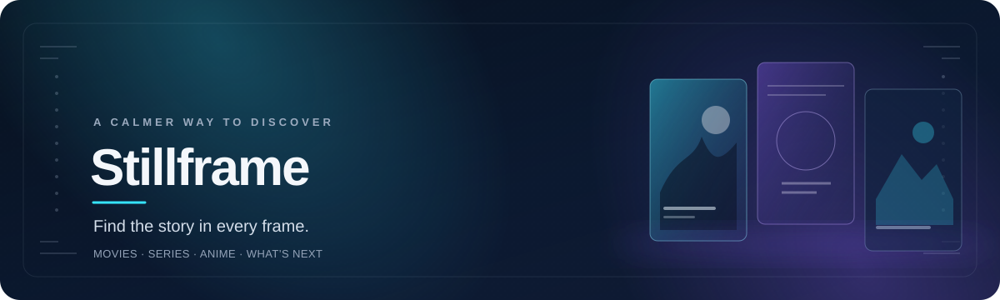
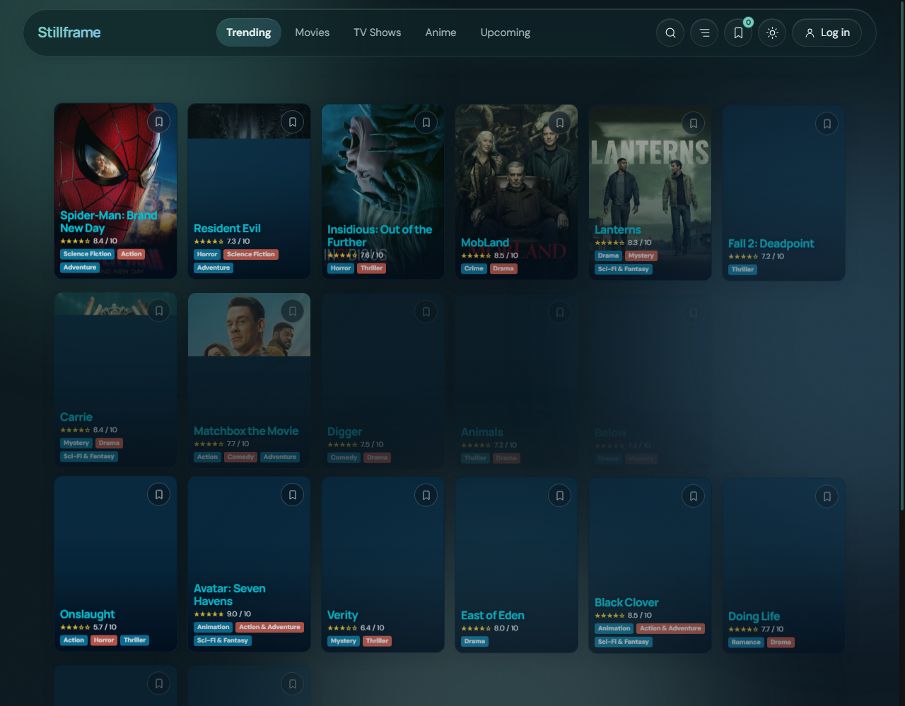
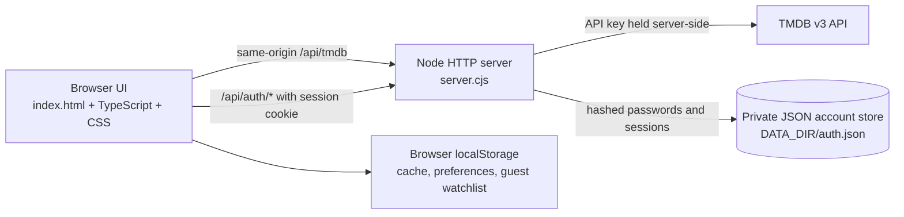

<div align="center">
  <a name="top"></a>
  

  <h1>Stillframe</h1>
  <p><strong>Find the story in every frame.</strong></p>
  <p>A cinematic discovery catalog for exploring movies, television, seasonal anime and upcoming releases, powered by TMDB.</p>

  <p>
    
    
    
  </p>

  <p>
    <a href="#experience">Experience</a> ·
    <a href="#preview">Preview</a> ·
    <a href="#technology">Technology</a> ·
    <a href="#getting-started">Get started</a> ·
    <a href="#architecture">Architecture</a> ·
    <a href="#quality">Quality</a>
  </p>
</div>

## A quieter kind of discovery

Stillframe brings a curated-feeling catalog and title details into one responsive web app. Browse live TMDB catalogs, refine them with filters, search movies, shows and people, and keep a watchlist in the browser or with an account.

<a id="preview"></a>
## Preview

<div align="center">
  
  <p><em>Trending discovery in the running application · captured locally at 1280 × 1000.</em></p>
</div>

## Experience

| Discover | Refine | Explore | Keep |
| --- | --- | --- | --- |
| **Trending**, **Movies**, **TV Shows**, **Anime**, and **Upcoming** catalogs load live titles from TMDB. Upcoming can be narrowed to movies, TV, anime or Asian dramas. | Sort by popularity, rating or title; filter by language, release status and upcoming category. Anime has a season/year selector. | Poster cards reveal synopsis and cast context. Movie and TV detail routes include title information and interactive detail tabs. | Global multi-search returns title and people matches. Save titles locally, or sign in to sync your watchlist across sessions. |

The interface uses a dark/light theme, responsive poster grids, loading skeletons, retry/empty states, and load-more plus intersection-observer pagination. The desktop grid is tuned for five or more cards across; mobile retains its two-column layout.

## Technology

| Area | Implementation |
| --- | --- |
| Frontend | Semantic HTML, custom CSS, strict TypeScript (ES2022 modules) |
| Server | Node.js built-in HTTP server (`server.cjs`); static-file delivery and same-origin API routes |
| Media data | TMDB v3 API through a constrained server-side proxy |
| Accounts | First-party JSON account store; `scrypt` password hashes and opaque, server-side sessions |
| Browser persistence | Local storage for preferences, TMDB response cache and anonymous watchlist |
| Tests | Node's built-in test runner; integration and Chrome DevTools Protocol browser flow tests |
| Dependencies | TypeScript for development/build; no frontend runtime framework |

## Getting started

### Prerequisites

- Node.js 18 or later and npm.
- A TMDB v3 API key for live catalog data. Keep the key on the server; never add it to browser code.

### Install and run

```sh
git clone https://github.com/mang0088/SPA.git
cd SPA
npm install
cp .env.example .env
# Add your TMDB API key to .env, then:
npm run dev
```

Open <http://127.0.0.1:8080>. `npm run dev` first runs the strict TypeScript build and then starts the server. `npm start` starts the server without rebuilding; run `npm run build` first after source changes.

### Configuration

| Variable | Required? | Purpose | Safe example |
| --- | --- | --- | --- |
| `TMDB_API_KEY` | Yes for live catalog data | Server-only credential for TMDB v3 requests | `replace-with-your-own-tmdb-v3-api-key` |
| `DATA_DIR` | No | Directory for `auth.json` (defaults to `./data`) | `./data` |
| `SESSION_COOKIE_SECURE` | No | Set to `1` behind HTTPS to mark the session cookie `Secure` and emit HSTS | `1` |
| `PORT` | No | HTTP listening port (defaults to `8080`) | `8080` |
| `HOST` | No | Bind address (defaults to `127.0.0.1`) | `127.0.0.1` |

`DATA_DIR` should point to a private persistent directory outside tracked and static asset paths. The default `./data` directory is git-ignored. On production HTTPS, configure the proxy and set `SESSION_COOKIE_SECURE=1`.

<details>
  <summary>Account API and operational notes</summary>

  - `POST /api/auth/signup` accepts `displayName`, `email`, and `password` (8–128 characters); duplicate email returns `409`.
  - `POST /api/auth/login` and `POST /api/auth/logout` use JSON; `GET /api/auth/session` reads the HttpOnly session cookie.
  - `GET /api/auth/watchlist` and `PUT /api/auth/watchlist` require a valid session. The server validates watchlist records and caps the list at 500 titles.
  - Account request bodies are size-limited and account endpoints are rate-limited per remote address. Session cookies are `HttpOnly` and `SameSite=Lax`; `Secure` is conditional on HTTPS deployment configuration.
  - TMDB API access is proxied by the server so the credential is not sent to the browser. TMDB/network access is required for live catalog results.

</details>

## Architecture



### Project map

```text
.
├── index.html           # Static HTML shell and metadata
├── css/main.css         # Themes, catalog cards, detail UI and responsive layout
├── src/
│   ├── main.ts          # UI, navigation, global search and application state
│   ├── catalog.ts       # Catalog query construction and TMDB item mapping
│   ├── tmdb.ts          # Same-origin TMDB client, cache and in-flight request sharing
│   ├── auth.ts          # Typed client for the account API
│   ├── cache.ts         # Memory/localStorage cache helpers
│   └── types.ts         # Shared catalog and TMDB types
├── server.cjs           # Static server, TMDB proxy and account API
├── test/                # Catalog, account and browser-flow tests
├── docs/
│   ├── assets/           # README artwork
│   └── BRAINSTORM.md     # Product research and staged roadmap notes
└── package.json          # Build, run and test scripts
```

## Quality

```sh
npm run build   # Strict TypeScript compile to dist/
npm test        # Build plus Node integration and browser-flow tests
npm run verify  # Alias for npm test
```

The browser-flow test launches headless Chrome from `C:\Program Files\Google\Chrome\Application\chrome.exe`; adjust that test configuration if your local Chrome installation differs. There is no separate lint script or production bundler configured.

## Security and privacy

- Keep `.env` private; `.env` and account data directories are git-ignored.
- Passwords are stored as salted `scrypt` hashes. Session tokens are random, stored server-side as SHA-256 digests, and revoked on logout.
- Static serving blocks the account store, including when a custom `DATA_DIR` is configured beneath the app root.
- The server constrains TMDB proxy paths and sends browser security headers, including a Content Security Policy.
- This repository does not include a dedicated security reporting policy. Avoid posting unpatched vulnerability details in a public issue.

## Current scope

The app has movie and TV title-detail routes, account signup/login/logout, a local and authenticated watchlist, and global multi-search. Password reset and email verification are not implemented. The project is an incremental catalog application, not a production identity platform; the JSON account store is designed for a single server instance and is not a shared multi-instance database.

## Data attribution

Stillframe uses the TMDB API but is **not endorsed or certified by TMDB**. Live data requires a developer-supplied TMDB API key and is subject to TMDB’s terms and usage policies. Artwork and media metadata are supplied by TMDB and their respective rights holders.

## Contributing

No contribution guide or license file is currently present. Before opening a pull request, run `npm test`; changes to the app should preserve strict TypeScript compilation and existing browser flows. Please clarify licensing and contribution terms with the project maintainers before redistributing this repository.

<div align="center">
  <sub>Stillframe · discover what to watch next</sub><br />
  <a href="#top">Back to top ↑</a>
</div>
